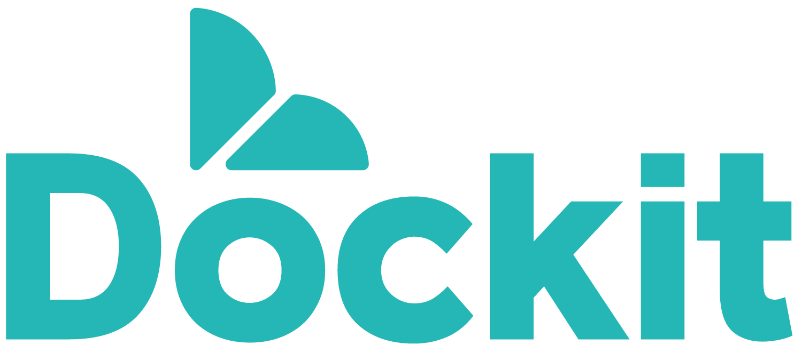
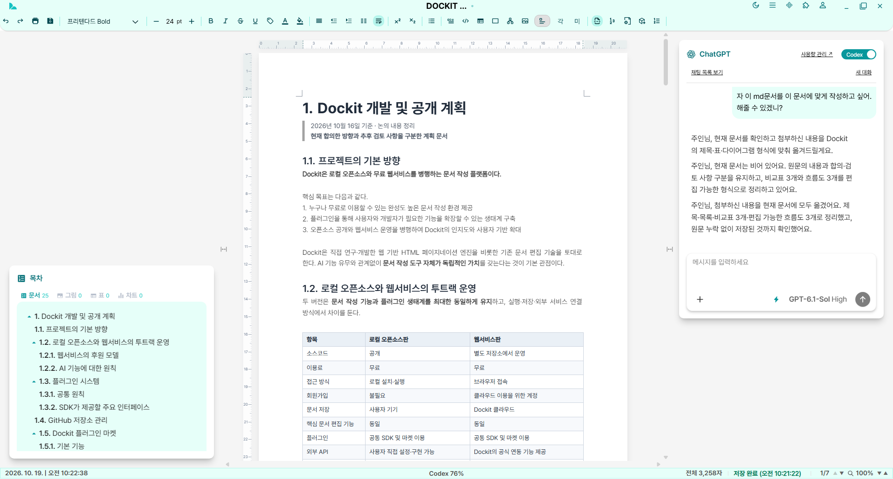
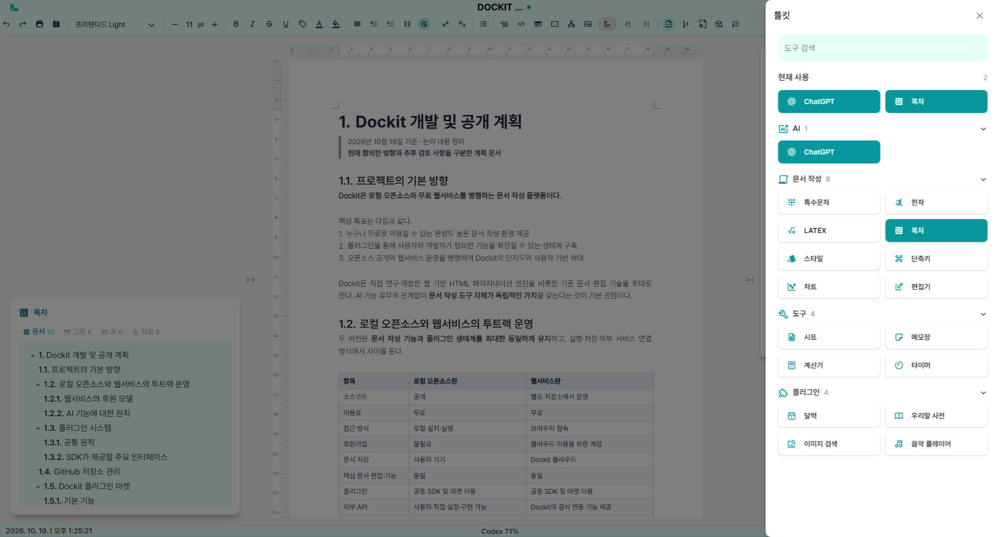
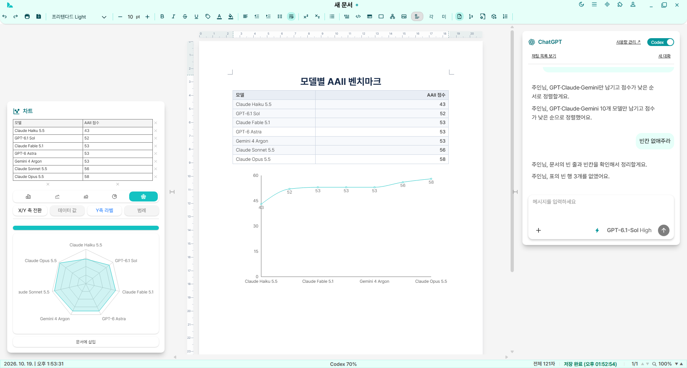
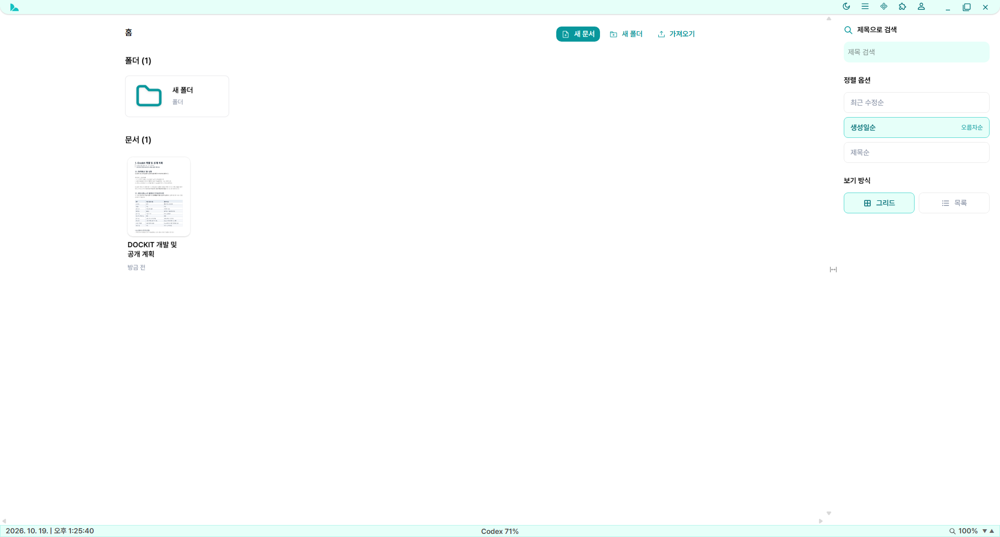
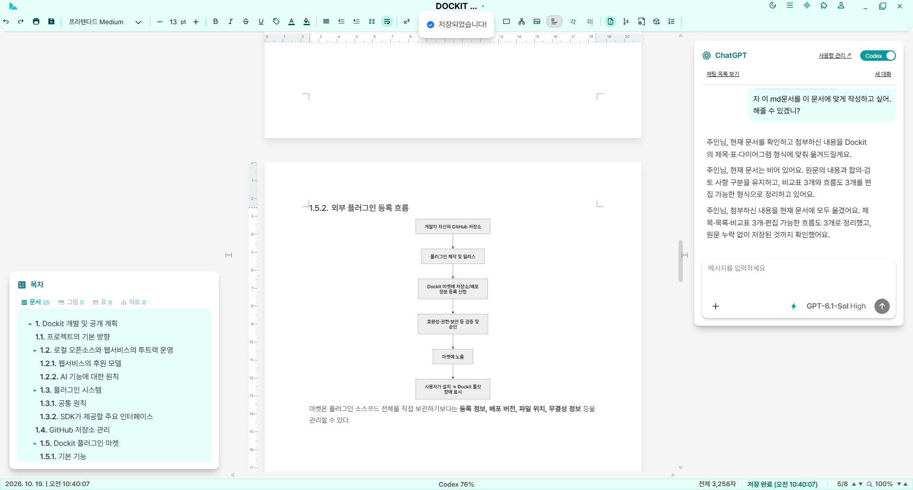
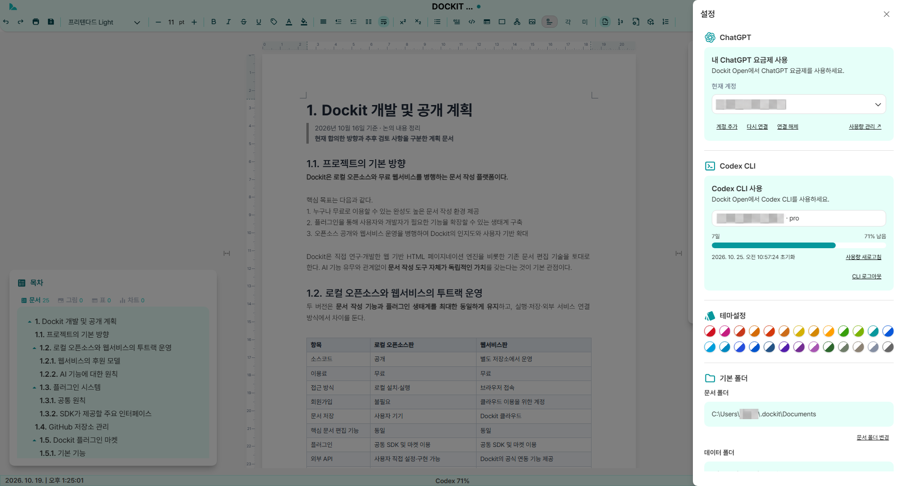
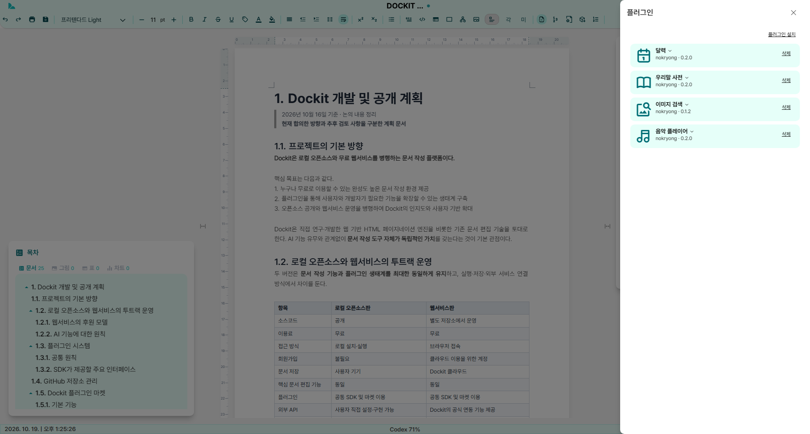

<p align="center">
  
</p>

<p align="center">
  A document editor that runs on your own computer, no account required
</p>

<p align="center">
  <a href="README.ko.md">한국어</a> ·
  <a href="https://github.com/nokryong/Dockit-open/releases">Download</a> ·
  <a href="https://github.com/nokryong/dockit-plugins">Plugins</a>
</p>



Dockit Open is an open-source document editor for Windows, macOS, and Linux. Your documents stay on your computer without an account or a server, and you can optionally connect ChatGPT or the Codex CLI to help with your writing.

The interface supports Korean and English. By default it follows your system language and falls back to English. You can change it in Settings → Language.

## Features

- **Paged document editing** with tables, LaTeX math, images, charts, Mermaid diagrams, footnotes and endnotes, and a table of contents.
- **HWPX and DOCX**: import and export Hangul (HWPX) and Word (DOCX) files.
- **Local storage**: documents are saved as `.dkt` files on your computer. Deleted documents go to the OS trash.
- **Toolkits** docked beside the document: ChatGPT, special characters, Hanja, LaTeX, table of contents, styles, shortcuts, charts, object editor, sheets, notes, calculator, and timer.
- **Optional AI**: connect your ChatGPT account or the Codex CLI to chat and delegate document work. No API key or extra server is needed.
- **Plugins**: install and update plugins from a GitHub address.



Select a table and the Chart toolkit turns it into a chart you can insert into the document.



## Download and install

Get the file for your operating system from [Releases](https://github.com/nokryong/Dockit-open/releases).

| OS | File |
|---|---|
| Windows | `.exe` installer |
| macOS | `.dmg` |
| Linux | `.AppImage` |

The installers are not code-signed. If you see a security warning on first launch:

- **Windows**: in "Windows protected your PC", choose **More info → Run anyway**.
- **macOS**: if the app is blocked, open **System Settings → Privacy & Security** and choose **Open Anyway**.
- **Linux**: make the file executable (`chmod +x Dockit*.AppImage`) and run it.

### Updates

The app checks for a new version shortly after launch and every six hours.

- **Windows and Linux**: choose **Install** in the update notice. The app downloads the update, saves open documents, and restarts.
- **macOS**: automatic installation needs code signing, so the notice opens the release page instead. Download the new version and replace the app.

## Where your data lives



Everything is stored in the `.dockit` folder in your home directory.

| Location | Contents |
|---|---|
| `.dockit/Documents/` | `.dkt` documents and folders (you can choose another folder in Settings) |
| `.dockit/backups/` | The previous saved copy of each document |
| `.dockit/config.json` | Settings, theme, and panel layout |
| `.dockit/memos/`, `.dockit/characters/`, `.dockit/styles/` | Notes, favorite characters, and custom styles |
| `.dockit/plugins/`, `.dockit/plugin-data/` | Installed plugins and their data |
| `.dockit/ai/`, `.dockit/codex/` | Encrypted AI connection data and chat history |

Changing the documents folder does not move or delete existing documents.

## AI connections

AI is optional. Every editing feature works without it.



### ChatGPT

Choose **Continue with ChatGPT** at the top of Settings, sign in with your default browser, and allow plan usage. Then pick a model your account can use in the ChatGPT toolkit.

- Chats use your connected ChatGPT plan or credits. See limits under **Manage usage**.
- Chat history stays on your computer. Only the current conversation is sent to OpenAI when you send a message; document files are never sent automatically.
- Credentials are protected with OS encryption.
- Availability and account requirements follow [OpenAI's documentation](https://developers.openai.com/siwc/token-sharing-open-source). Image generation is not supported through this connection.

### Codex CLI

Install the Codex CLI (`npm install -g @openai/codex`) and choose **Sign in with CLI** in Settings. After signing in, switch the ChatGPT toolkit to Codex with the **Chat/Codex** toggle in its top-right corner.



- When you ask, Codex can edit the open document directly. Editing is locked while it works.
- Your global Codex `AGENTS.md` and personal skills are used as well.
- CLI credentials are stored separately in `.dockit/codex/`, independent of your default `~/.codex` sign-in. Do not share `.dockit/codex/auth.json`.

## Plugins

Choose **Plugins → Install plugin** and enter a GitHub repository or plugin folder address. Open installed plugins from **Toolkits → Plugins**. When a new version is available, choose **Update** in the plugin manager; saved data and API keys are kept.



Enter the [official plugin repository](https://github.com/nokryong/dockit-plugins) to choose from:

| Plugin | Description |
|---|---|
| Dice | Add dice and roll them. |
| Image Search | Search and download Pixabay images (requires your own Pixabay API key). |
| Korean Dictionary (우리말 사전) | Look up words in Urimalsaem. |
| Calendar | Keep events by date. |
| Music Player | Play the songs in a music folder you choose. |

Plugins run in an isolated frame and cannot access your document files or sign-in data. To build one, see the [Plugin SDK v2](docs/plugins/SDK.md) and [dockit-plugin-sdk](https://github.com/nokryong/dockit-plugin-sdk). To list a plugin in the official repository, open a pull request following its [contribution guide](https://github.com/nokryong/dockit-plugins/blob/main/CONTRIBUTING.md). You can also install plugins from other public GitHub repositories, but those are not reviewed by the official repository.

## Build from source

Requires Node.js 24 or later. No database or environment variables are needed.

```sh
npm install
npm run dev
```

`npm run dev` starts the dev server and the app together and reloads UI changes on save. Restart it after changing Electron main-process code.

```sh
npm run build            # build the UI
npm start                # run the built app
npm run package:desktop  # create installers for the current OS in release/ (no upload)
```

See [TESTING.md](TESTING.md) for checks and [docs/desktop-updates.md](docs/desktop-updates.md) for packaging and updates.

## Contributing

Bug reports, ideas, and pull requests are welcome. Please read [CONTRIBUTING.md](CONTRIBUTING.md) first. Report security issues privately as described in [SECURITY.md](SECURITY.md), not in public issues.

## License

Dockit Open is released under the [GNU AGPL v3.0](LICENSE). Third-party notices and license texts are in [THIRD_PARTY_NOTICES.txt](public/THIRD_PARTY_NOTICES.txt). The Intel One Mono code font is licensed under the [SIL Open Font License 1.1](public/fonts/IntelOneMono-OFL.txt).
